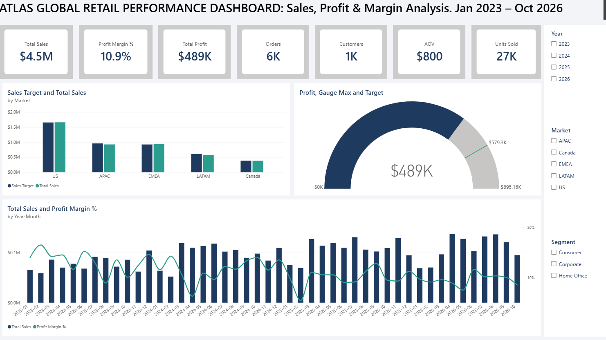
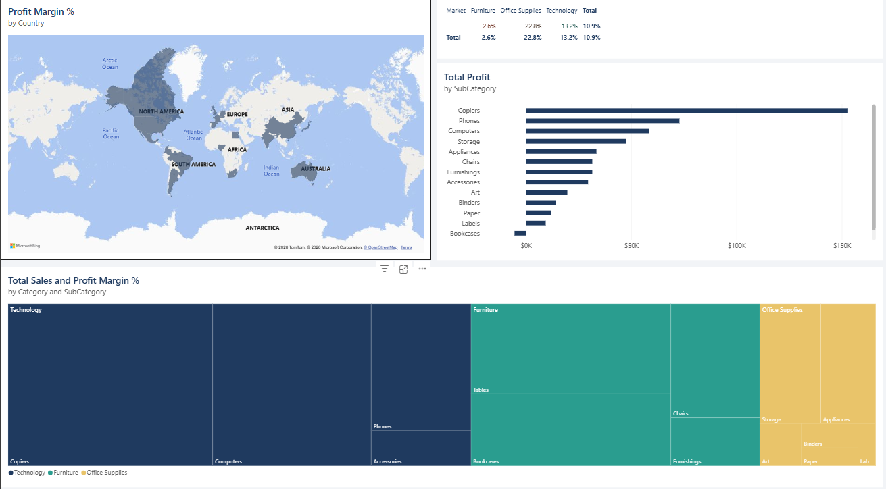
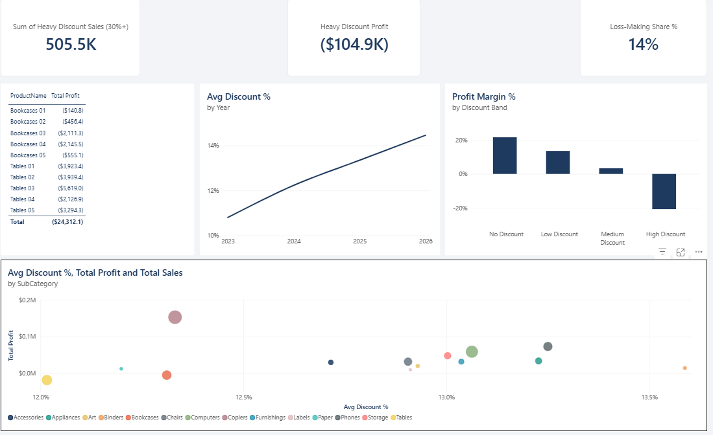
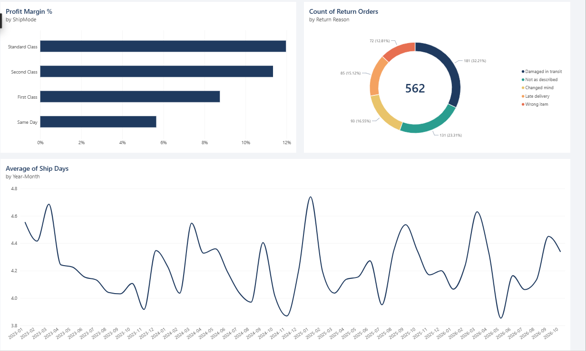

# Atlas Global Retail: Why Is Profit Flat While Sales Boom? (Power BI)

**Analyst:** [Nuelwumi2024](https://github.com/Nuelwumi2024) · **Tools:** Power BI, DAX, Power Query, Python

> **Disclaimer:** *Atlas Global Retail* is a fictional company and all data is synthetic (seeded and reproducible with `src/generate_data.py`). This is a portfolio case study, not a real engagement.

> **Status:** complete. The finished report is [`report/Atlas_Sales_Profit_Analysis.pbix`](report/Atlas_Sales_Profit_Analysis.pbix) (open in Power BI Desktop on Windows). Data, DAX, theme and a rebuild guide are included.

  

**Contents:** [Scenario](#1-the-scenario) · [Questions](#2-business-questions) · [Data model](#3-data-model) · [Metrics](#4-metrics-what-each-kpi-means-and-how-it-is-calculated) · [Build guide](#5-build-guide) · [Findings](#6-what-the-data-shows-verify-against-your-build) · [Recommendations](#7-recommendations) · [Skills](#8-skills-demonstrated)

---

## Dashboard Preview

A four-page report that moves from *how are we doing* to *where is the money leaking*. Key readings below each page come directly from the report.

### Page 1: Executive Overview


**$4.5M sales, $488.8K profit, 10.9% margin** across about 6K orders and 1K customers (Jan 2023 to Oct 2026), with Year, Market and Segment slicers. Monthly sales are plotted in date order against profit margin, which shows Q4 sales peaks and a margin that has drifted from the mid-teens in 2023 towards 10%. A gauge shows **profit of $488.8K against a target of $579.3K, about 84% of target**, and a chart compares sales with target by market: **sales are within about 1% of target overall, so the shortfall is in profit, not in sales volume.**

### Page 2: Where Profit Is Made and Lost


**Technology earns the most profit, led by Copiers, Phones and Computers. Office Supplies has the best margin (22.8%) and Furniture the worst (2.6%).** Bookcases are loss-making. A Market × Category matrix shows where margin is thinnest: **Furniture loses money in EMEA (-3.5%) and LATAM (-2.0%)**, while Canada is the strongest market in every category (17.8% overall, against 5.1% in EMEA and 6.0% in LATAM). A map shows margin by country, and a treemap shows how sales are split by category and sub-category.

### Page 3: Discount Damage


**Orders discounted 30% or more bring in $505.5K of sales and lose $104.9K.** The average discount has crept up every year, and margin falls from about 22% with no discount to negative at high discounts. All ten Tables and Bookcases products are loss-making, and 14% of order lines lose money.

### Page 4: Operations


**Faster shipping costs margin:** Standard Class earns about 12% against about 6% for Same Day. Of 562 returned orders, **"Damaged in transit" is the top reason (32%)**, followed by "Not as described" (23%). Average ship days move between about 3.9 and 4.7 days month to month, with no clear improvement over the period.

---


**Atlas Global Retail** sells technology, furniture and office supplies to consumers, corporates and home offices in five markets: US, Canada, EMEA, APAC and LATAM.

It is November 2026. You have just joined as **Commercial Data Analyst**, and the 2027 budget is due in six weeks. In your first week the COO shows you one slide (January to October each year, so the comparison is like for like):

| Jan-Oct | 2023 | 2026 | Change |
|---|---|---|---|
| Sales | $0.76M | $1.09M | **+43%** |
| Profit | $98K | $104K | **+6%** |
| Profit margin | 12.9% | 9.6% | **-3.3 pts** |

> *"We're selling more every year and making almost no extra money. Where is the profit going, and what do we do about it before the 2027 budget is set?"*

Your job is to find out, and to hand the COO something she can act on.

## 2. Business Questions

1. **Performance:** how are we doing against targets, and where are we falling short?
2. **Profitability:** which products, categories and markets make or lose money?
3. **Pricing:** are discounts driving growth, or destroying margin?
4. **Operations:** do shipping speed and returns eat into profit?

## 3. Data Model

Star schema with five tables plus a date table. Returns arrive as a separate file and are merged in Power Query.

| Table | Rows | Role |
|---|---|---|
| `orders` | 9,818 | Fact: one row per order line (sales, profit, discount, shipping cost, quantity) |
| `customers` | 1,500 (1,261 have ordered) | Dimension: segment, market, region, country |
| `products` | 70 | Dimension: category, sub-category, list price |
| `returns` | 562 | Merged into `orders` in Power Query (Returned, ReturnReason) |
| `targets` | 20 | Sales and profit targets per market and year (2026 is the year-to-date target) |
| `DateTable` / `Markets` | , | Calculated in DAX |

```
customers 1 ──< orders >── 1 products          Markets 1 ──< customers
DateTable 1 ──< orders                         Markets 1 ──< targets
```

Full relationships and every formula: [`dax/measures.dax`](dax/measures.dax).

## 4. Metrics (what each KPI means and how it is calculated)

| Metric | Definition | DAX idea |
|---|---|---|
| **Sales** | Revenue after discount | `SUM(Sales)` |
| **Profit** | Sales minus product cost and shipping cost | `SUM(Profit)` |
| **Profit Margin %** | Share of sales kept as profit | `Profit ÷ Sales` (never average the margin column) |
| **Orders** | Distinct orders (an order can have several lines) | `DISTINCTCOUNT(OrderID)` |
| **Customers** | Distinct buying customers | `DISTINCTCOUNT(CustomerID)` |
| **AOV** | Average order value | `Sales ÷ Orders` |
| **Units Sold** | Total quantity | `SUM(Quantity)` |
| **Avg Discount %** | Mean discount per line | `AVERAGE(Discount)` |
| **Discounted Sales %** | Share of sales sold at any discount | `CALCULATE(Sales, Discount>0) ÷ Sales` |
| **Shipping Cost %** | Shipping cost as a share of sales | `SUM(ShippingCost) ÷ Sales` |
| **Avg Ship Days** | Days from order to dispatch | `AVERAGE(ShipDate - OrderDate)` |
| **Return Rate %** | Orders returned ÷ orders | `CALCULATE(DISTINCTCOUNT(OrderID), Returned="Yes") ÷ Orders` |
| **Sales / Profit YoY %** | Growth versus the same period last year | `SAMEPERIODLASTYEAR` |
| **Sales YTD / Rolling 12M** | Running totals | `TOTALYTD`, `DATESINPERIOD` |
| **Sales / Profit vs Target %** | Actual against budget | `Actual ÷ Target - 1` |
| **Loss-Making Lines / Loss Value** | Order lines with negative profit, and their total | `CALCULATE(..., Profit<0)` |

## 5. Build Guide

### Step 1: Load and clean (Power Query)
1. **Get Data → Text/CSV** and load all five CSVs from `data/`.
2. In `orders`: set `OrderDate` and `ShipDate` to **Date**, and `Sales`, `Profit`, `Discount`, `ShippingCost` to **Decimal Number**.
3. **Merge queries:** `orders` with `returns` on `OrderID`, **Left Outer**. Expand `ReturnReason` and `Returned`.
4. **Replace nulls:** `Returned` null → `No`, `ReturnReason` null → `None`.
5. Untick **Enable load** on the `returns` query. Set key columns in `customers`, `products` to text. **Close & Apply**.

### Step 2: Model
1. Create `DateTable` and `Markets` (**New table**) from the first lines of `measures.dax`. Mark `DateTable` as a date table.
2. Add the relationships shown in section 3 (all single direction, one-to-many).
3. Add the calculated columns, then the measures, into a `_Measures` table.
4. Import `theme/atlas-theme.json` via **View → Themes → Browse for themes**.

### Step 3: Build the four pages

| Page | Title | Story |
|---|---|---|
| 1 | **Executive Overview** | Growth is real, profit is not keeping up |
| 2 | **Where Profit Is Made and Lost** | Products and markets |
| 3 | **Discount Damage** | Pricing is the main leak |
| 4 | **Operations: Shipping & Returns** | Smaller leaks |

**Page 1: Executive Overview**
- **Cards:** Sales, Profit, Profit Margin %, Orders, AOV, Sales YoY %
- **Combo chart (columns + line):** Sales by year-month as columns, Profit Margin % as a line
- **Clustered column:** Sales vs Sales Target by Market
- **Gauge or KPI visual:** Profit vs Target %
- **Slicers:** Year, Market, Segment

**Page 2: Where Profit Is Made and Lost**
- **Treemap:** Sales by Category and Sub-Category, coloured by Profit Margin %
- **Bar chart (diverging colours):** Profit by Sub-Category, with losses in red
- **Filled map or bar:** Profit Margin % by Country
- **Matrix:** Market × Category, values = Profit Margin %, with conditional formatting

**Page 3: Discount Damage**
- **Column chart:** Profit Margin % by Discount Band
- **Scatter:** Discount % against Profit by sub-category
- **Cards:** Heavy Discount Sales (30%+), Heavy Discount Profit (30%+), Loss-Making Share %
- **Table:** the 10 most loss-making products (Top N filter on Profit)
- **Line chart:** Avg Discount % by year (discount creep)

**Page 4: Operations: Shipping & Returns**
- **Bar chart:** Profit Margin % by Ship Mode, plus Shipping Cost %
- **Column chart:** Return Rate % by Market and by Category
- **Donut:** Returned orders by ReturnReason
- **Line chart:** Avg Ship Days by month

### Step 4: Polish (what recruiters notice)
- **Drill-through** from any market to a Market Detail page
- **Bookmarks and buttons** for a page navigation bar and a "Reset filters" button
- **Tooltip pages** for the KPI cards
- **Dynamic title** using the `Page Title` measure
- **Conditional formatting** using `Margin Colour`
- Consistent theme, aligned visuals, no clutter, and a short subtitle on every chart

## 6. What the Data Shows (verify against your build)

The data covers **1 January 2023 to 28 October 2026** (2026 is year to date), so use Jan-Oct comparisons or full years 2023-2025 when measuring growth.

- **Growth without profit:** comparing January-October each year, sales grew 43% between 2023 and 2026 while profit grew 6%, so margin fell from 12.9% to 9.6%.
- **Discounts are the main culprit.** Average discount rose from 10.8% in 2023 to 14.5% in 2026. Lines discounted 30% or more generated about **$506K of sales and a $105K loss**. Margin is about 22% with no discount, 14% at 10%, 3% at 20% and negative from 30%.
- **Furniture is the problem category:** $1.5M of sales but only about 3% margin. **Tables and Bookcases lose money** (about -$19K and -$5K) even though they are bestsellers.
- **Technology earns the most profit** ($314K), led by Copiers ($153K). **Office Supplies has the best margin** (about 23%) but small volume.
- **Markets differ sharply:** Canada has about 18% margin and the US about 14%. **EMEA** sells $0.93M at only about 5% margin, and **LATAM** about 6%. Both discount heavily.
- **Shipping:** Same Day earns about 6% margin and First Class 9%, against 12% for Standard Class.
- **Returns:** about 10% of orders are returned, rising to about 22% in LATAM and about 15% for Furniture.
- **Targets:** 2026 sales are about 1.5% under target, but **every market is behind on profit**, by about 21% overall.

## 7. Recommendations

| Priority | Action | Why |
|---|---|---|
| 1 | **Cap discounts at 20%** and require approval above that | Lines at 30%+ lose money, and margin falls from about 22% to 3% between no discount and 20% off |
| 2 | **Reprice or delist Tables and Bookcases** | Loss-making at any meaningful discount |
| 3 | **Review EMEA and LATAM discount policy** | Large markets with 5-6% margin |
| 4 | **Charge for Same Day and First Class shipping** | Thin margins at these speeds |
| 5 | **Look into LATAM returns** (damage in transit, delivery times) | Return rate is about double other markets |

## 8. Skills Demonstrated

| Area | Evidence in this project |
|---|---|
| **Data modelling** | Star schema, role of dimensions, a calculated Markets dimension, `TREATAS` for budget data |
| **Power Query (ETL)** | Type cleaning, **merging** returns into orders, null handling, disabling load on staging queries |
| **DAX** | Time intelligence (`SAMEPERIODLASTYEAR`, `TOTALYTD`, `DATESINPERIOD`), `RANKX`, `TOPN`, `SUMX`, `TREATAS`, variables |
| **Analytics** | Margin analysis, budget vs actual, discount impact, return analysis |
| **Visualisation** | Combo, treemap, scatter, matrix heatmap, gauge, conditional formatting |
| **Report design** | Drill-through, bookmarks, tooltips, dynamic titles, custom theme |
| **Business storytelling** | A clear question, findings, costed recommendations |

## 9. Repository

```
data/    orders, customers, products, returns, targets (synthetic CSVs)
dax/     measures.dax - every calculated table, column and measure
theme/   atlas-theme.json - custom Power BI theme
report/  Atlas_Sales_Profit_Analysis.pbix - the finished report
images/  dashboard screenshots (pages 1-4)
src/     generate_data.py - reproduces the data
```

```bash
pip install pandas numpy
python src/generate_data.py
```

## 10. About

Built by **[Nuelwumi2024](https://github.com/Nuelwumi2024)**. See also: [HR Attrition case study (Power BI)](https://github.com/Nuelwumi2024/powerbi-hr-attrition-dashboard) and the [Excel sales dashboard](https://github.com/Nuelwumi2024/excel-retail-sales-dashboard).
